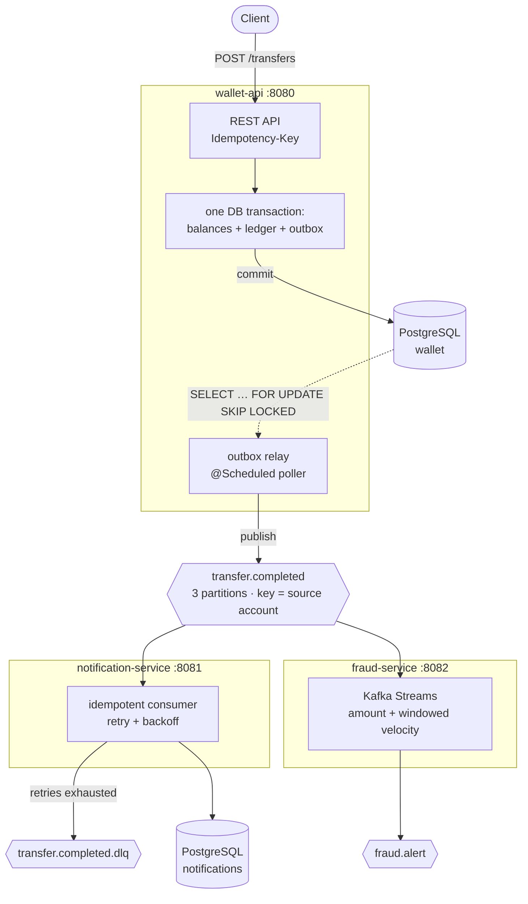

# kafka-wallet

An event-driven money transfer system built to practise the problems that make Kafka hard — not the
ones that make a wallet hard.

The business rule is deliberately trivial: move an amount from one account to another. Everything
interesting is in the plumbing around it — guaranteeing that an event is published **if and only
if** the money moved, surviving duplicate delivery, failing without losing messages, and being able
to see all of it from the outside.

**Stack:** Java 21 · Spring Boot 4.1 · Apache Kafka 4.1 (KRaft) · PostgreSQL 17 · Flyway ·
Kafka Streams · Testcontainers · Prometheus + Grafana

---

## Architecture



### The three services

| Service | Port | Responsibility |
|---|---|---|
| **wallet-api** | 8080 | REST API, balances, double-entry ledger, transactional outbox + relay |
| **notification-service** | 8081 | Idempotent consumer with retry, backoff and dead-lettering |
| **fraud-service** | 8082 | Kafka Streams rules: amount threshold and windowed velocity |

`common-events` holds the event contracts shared between them — plain records with no framework
types, so the contract cannot accidentally grow a dependency on either side's internals.

### Topics

| Topic | Key | Partitions | Producer | Consumers |
|---|---|---|---|---|
| `transfer.completed` | source `accountId` | 3 | wallet-api relay | notification-service, fraud-service |
| `transfer.completed.dlq` | unchanged | 1 | error handler | humans |
| `fraud.alert` | `accountId` | 3 | fraud-service | — |

---

## Running it

Requires Docker and a JDK 21+. Maven comes with the repo (`./mvnw`).

```bash
# 1. Infrastructure: Kafka (KRaft), Postgres, Kafka UI, Prometheus, Grafana
docker compose up -d

# 2. Build everything
./mvnw install -DskipTests

# 3. Each service in its own terminal
./mvnw -pl wallet-api spring-boot:run
./mvnw -pl notification-service spring-boot:run
./mvnw -pl fraud-service spring-boot:run
```

The application services are intentionally **not** in `docker-compose.yml`. Half the value of this
project is restarting one consumer and watching a rebalance, or killing the broker mid-batch and
watching the outbox hold the line — which is much easier when they are processes you control.

| What | Where |
|---|---|
| Kafka UI | http://localhost:8089 |
| Grafana (anonymous, dashboard `kafka-wallet`) | http://localhost:3000 |
| Prometheus | http://localhost:9090 |
| Swagger UI | http://localhost:8080/swagger-ui.html (wallet-api), http://localhost:8081/swagger-ui.html (notification-service) |
| Actuator | `/actuator/health`, `/actuator/prometheus` on each service |

### A full walkthrough

```bash
# Open two accounts
ALICE=$(curl -sX POST localhost:8080/accounts -H 'Content-Type: application/json' \
  -d '{"ownerName":"Alice","initialBalance":"1000.00","currency":"BRL"}' | jq -r .id)

BOB=$(curl -sX POST localhost:8080/accounts -H 'Content-Type: application/json' \
  -d '{"ownerName":"Bob","initialBalance":"0.00","currency":"BRL"}' | jq -r .id)

# Transfer. The Idempotency-Key is required.
curl -isX POST localhost:8080/transfers \
  -H 'Content-Type: application/json' \
  -H "Idempotency-Key: demo-001" \
  -d "{\"fromAccountId\":\"$ALICE\",\"toAccountId\":\"$BOB\",\"amount\":\"150.00\",\"currency\":\"BRL\"}"
# -> 201 Created

# Send it again, byte for byte
curl -isX POST localhost:8080/transfers \
  -H 'Content-Type: application/json' \
  -H "Idempotency-Key: demo-001" \
  -d "{\"fromAccountId\":\"$ALICE\",\"toAccountId\":\"$BOB\",\"amount\":\"150.00\",\"currency\":\"BRL\"}"
# -> 200 OK, same transferId, Alice still has 850.00

# The ledger: one DEBIT and one CREDIT, and they cancel out
curl -s localhost:8080/accounts/$ALICE/ledger | jq

# The consumer notified exactly once
curl -s localhost:8081/notifications/count
```

`docs/requests.http` has the same flow as an editor-runnable file (IntelliJ, VS Code REST Client).

### The event on the wire

```json
{
  "eventId": "7f3c2a1e-9b4d-4c21-8f66-1d2e3a4b5c6d",
  "eventType": "TransferCompleted",
  "occurredAt": "2026-10-05T14:30:00Z",
  "payload": {
    "transferId": "b1c2d3e4-5f60-4718-9a2b-3c4d5e6f7a8b",
    "fromAccount": "a1111111-1111-4111-8111-111111111111",
    "toAccount": "a2222222-2222-4222-8222-222222222222",
    "amount": "150.0000",
    "currency": "BRL"
  }
}
```

`eventId` is the deduplication key, and it is the primary key of the outbox row that produced the
event — so it is stable across republication.

---

## Design decisions

### Why the outbox pattern

Writing to the database and then producing to Kafka is two commits with nothing coordinating them.
Crash in between and you get one of two bad outcomes: money that moved with no event, or an event
for money that never moved. Neither is detectable after the fact.

The outbox makes the first commit atomic with the business change — the transfer, the ledger entries
and the "an event is owed" row all land in one transaction. A separate relay then moves the row to
Kafka and can fail as often as it likes, because the row is still there.

The cost is honest: the relay is **at-least-once**. If the broker acknowledges a send and the relay
dies before marking the row published, the event is republished. That is why
[consumer idempotency](#why-idempotent-consumers-and-not-exactly-once) is not optional.

### Why `SELECT … FOR UPDATE SKIP LOCKED`

It lets the relay scale horizontally. Each instance claims rows nobody else holds and *skips* the
rest rather than queueing behind them, so two relays never publish the same event and never block
each other. The partial index (`where published_at is null`) keeps the claim query proportional to
the backlog rather than to every event ever published.

### Why the message key is the source account

The key decides the partition, and Kafka only orders messages **within** a partition. Keying on the
source account puts every event for one account on one partition, so a consumer sees that account's
transfers in the order they happened. A random key would spread them across three partitions and
three consumer threads, where "A then B" becomes a coin flip.

It also pays off downstream: `fraud-service` can `groupByKey` without a repartition topic, because
the data is already grouped the way the rule needs.

### Why optimistic locking, not pessimistic

Two concurrent transfers touching the same account must not both read the old balance and write
their own total. Both locking strategies prevent that; they fail differently.

Pessimistic locking (`SELECT … FOR UPDATE` on both accounts) deadlocks the moment two opposite
transfers — A→B and B→A — lock in request order. Avoiding that means imposing a global lock order,
which is easy to get right once and easy to break later.

Optimistic locking has no deadlock to design around. It trades that for a failure that the caller
must handle: the `version` check fails and the transaction is doomed. So the retry sits *outside*
the transaction, in `TransferMoneyService`, with jittered exponential backoff — the jitter matters
more than the growth, since without it two contending transfers retry in lockstep and keep
colliding. After the budget is spent the client gets `409` with `retryable: true`.

### Why `Idempotency-Key` is required, not optional

A client that times out cannot distinguish a lost request from a lost response, and a transfer is
not safe to retry blindly. Making the header mandatory means every caller is retry-safe by
construction rather than by discipline.

Two details beyond the obvious unique constraint:

- **The constraint is the guarantee, not the lookup.** The service checks for an existing key first,
  but that check is not a lock — two identical requests can both miss it. The unique index settles
  the race, and the loser re-reads the winner's row and returns that.
- **The body is fingerprinted.** A SHA-256 of `(from, to, amount, currency)` is stored with the
  transfer. Replaying a key returns the original; reusing a key for a *different* transfer is a
  client bug, and gets `409` instead of silently succeeding with the wrong result.

### Why idempotent consumers and not exactly-once

Kafka's transactions could give exactly-once between topics, but the side effect here leaves Kafka —
it writes to another database. Exactly-once across a broker and an unrelated database needs a
distributed transaction, which is a much larger bill than the problem justifies.

So the system is at-least-once end to end, and the consumer makes reprocessing harmless:

```
BEGIN
  insert into processed_events (event_id, consumer) ... on conflict do nothing
  -- 0 rows affected? already done, skip.
  <do the work>
COMMIT
```

Both halves are load-bearing. Claiming in a separate transaction would drop events whenever the
work failed; doing the work without claiming would duplicate them on redelivery. And the claim is an
`insert … on conflict`, not a `select` then `insert`, because the latter lets two threads both read
"not processed".

### Why blocking retries, and what that costs

`DefaultErrorHandler` with `ExponentialBackOff` retries in place, then hands the record to
`DeadLetterPublishingRecoverer`. While a record is being retried its partition makes no progress.
For money movement that is a feature — events for one account must not overtake each other — and
it is why the backoff has both a hard interval ceiling and a hard attempt limit.

`@RetryableTopic` is the non-blocking alternative: failures are republished to `-retry` topics so
the main partition keeps moving. It buys throughput and costs ordering, which is the wrong trade
here.

Messages that can never succeed — malformed JSON, a missing `eventId` — are
`NonRetryableEventException` and skip the budget entirely. Retrying a broken message four times
just delays the inevitable while blocking its partition.

### Why the DLQ is not replayed automatically

Automatic replay recreates the loop the DLQ exists to break. A message that failed its whole budget
with backoff usually means a bad message or a broken dependency, and both need a human. The
`DeadLetterListener` therefore only logs and counts — a loud signal and a metric to alert on, rather
than a topic nobody notices until a customer calls.

### Why a hexagon in wallet-api and not in the others

`domain` and `application` in wallet-api compile without Spring on the classpath. There is no
`@Service` and no `@Transactional` in either — transactions are a port (`TransactionRunner`), and
the use cases are wired by hand in `UseCaseConfiguration`.

The payoff is visible in `TransferMoneyServiceTest`: contention, the duplicate-key race and the
retry budget are all unit-tested with in-memory fakes, no context to start, no mocking framework.
The rollback-aware fake transaction runner in that test is doing real work — a retry only succeeds
because the failed attempt left nothing behind.

`notification-service` and `fraud-service` get none of this structure, because they have no domain
to protect. They read an event, write some rows and are done. Matching the structure to the problem
is the decision; applying the same structure everywhere would just be ceremony.

### Smaller choices worth a line each

- **Money is `BigDecimal` / `NUMERIC(19,4)`,** and `Money` normalises with
  `RoundingMode.UNNECESSARY` — it throws rather than silently rounding away a fraction of a cent.
  Over-precise input is rejected at the REST boundary with `@Digits`.
- **Money crosses the wire as a JSON string.** A JSON number is an IEEE-754 double to most parsers,
  and JavaScript has no other option. `"150.0000"` survives a round trip; `150.0000` may not.
- **`ledger_entries.signed_amount` is a generated column,** so "every transfer nets to zero" is one
  `SUM()` away and cannot drift out of sync with `entry_type`. A unique index on
  `(transfer_id, entry_type)` makes a one-sided posting impossible.
- **Events are plain JSON strings,** not Spring's `JsonSerializer`. That serialiser stamps Java type
  headers into the message, which quietly couples consumers to this module's class names.
- **Topics are declared as `NewTopic` beans,** not auto-created. Auto-creation gives one partition,
  and partition count cannot be lowered later.
- **Each service owns its own database.** Not just its own tables — the moment one service can join
  against another's schema, the event stops being the contract.
- **`acks=all` and `enable.idempotence=true`.** With `acks=1`, a leader crash right after
  acknowledging loses the event while the outbox row is already marked published — the one hole the
  pattern cannot patch. Idempotence makes the producer's own retries safe to leave on.
- **Errors are RFC 7807 problem documents.** `422` for a request that cannot be satisfied (no funds)
  — retrying it unchanged will not help. `409` for a conflict the client may be able to resolve.

---

## Trade-offs and limitations

Things this project does *not* do, and what would change in production:

- **The relay is a 500 ms poller.** That latency is the floor on end-to-end event delay. Change
  Data Capture (Debezium reading the WAL) removes the poll entirely and gives lower latency, at the
  cost of running Kafka Connect.
- **The relay holds a database transaction while publishing.** Claim, publish and mark all happen
  in one transaction, so a broker outage keeps that transaction — and the rows it locked — open for
  up to `max.block.ms` plus the relay's send timeout. `max.block.ms` is therefore pinned to 5s
  rather than left at its 60s default; without that, a batch blocks inside `send()` for a minute per
  tick and never even reaches the timeout that would fail and retry it. Publishing outside the
  transaction would free the connection sooner, at the cost of a wider duplicate window.
- **A poison outbox row blocks the queue.** Rows are claimed in `created_at` order, so an event with
  no topic mapping fails its batch forever. Production needs a quarantine column and a skip
  threshold.
- **Published outbox rows are never deleted.** The table grows without bound. It needs a periodic
  reaper, and `published_at` is already indexed for it.
- **No schema registry.** JSON with hand-written records means a breaking change is found by a
  consumer at runtime. Avro or Protobuf with a registry moves that to the producer's build.
- **One broker, replication factor 1.** `acks=all` is almost meaningless with a single replica, and
  the broker is a single point of failure. Three brokers, RF 3, `min.insync.replicas=2`.
- **No authentication.** Any caller can move money from any account. A real system needs an
  authenticated principal and an authorisation check that the caller owns the source account, plus
  TLS and SASL on the broker.
- **`FailureInjector` exists in the main source set.** It is disabled by default and gated behind
  `notification.failure-injection.enabled`, but it would be a separate test-only profile in
  production.
- **Status is always `COMPLETED`.** Both ledger entries are posted in one transaction, so `PENDING`
  never survives a request. The state exists for the day a clearing step or a fraud hold is added.
- **Balances are read from the write model.** A statement or balance history at scale wants a read
  model fed by the events (CQRS) rather than more indexes on `ledger_entries`.

---

## Testing

```bash
./mvnw verify          # unit + integration, all modules
./mvnw test            # unit tests only (no Docker needed)
```

Integration tests start their own Postgres and Kafka with Testcontainers — no shared environment,
and CI runs exactly what a laptop runs.

| Test | What it proves |
|---|---|
| `MoneyTest`, `AccountTest`, `TransferTest` | Money arithmetic is exact; an overdraft leaves both accounts untouched; posting is double-entry |
| `TransferMoneyServiceTest` | Idempotent replay, body fingerprinting, retry on contention, giving up after the budget, losing the unique-constraint race — all with in-memory fakes |
| `TransferFlowIT` | End to end: request → transaction → outbox row → relay → topic. Asserts `published_at`, which only the relay can set |
| `IdempotencyIT` | Replay returns `200` with the original; a reused key with a different body is `409`; ten simultaneous identical requests collapse to one transfer and one event |
| `ConcurrentTransfersIT` | 50 concurrent transfers out of one account: the final balance equals the starting balance minus exactly what succeeded, and the ledger still sums to zero |
| `NotificationIdempotencyIT` | The same `eventId` delivered three times produces one notification |
| `RetryAndDeadLetterIT` | A transient failure recovers after retries; a permanent one is dead-lettered with its original topic and cause in the headers; malformed JSON skips the retries |
| `FraudTopologyTest` | Both rules, including window boundaries and per-account isolation, with `TopologyTestDriver` — no broker |

---

## Observability

Every service exposes `/actuator/prometheus`. Prometheus scrapes them through
`host.docker.internal`; Grafana provisions the `kafka-wallet` dashboard automatically.

The two panels that matter:

- **`wallet_outbox_backlog`** — unpublished rows. Oscillating near zero is healthy. A line that
  climbs means the relay is losing ground to the write rate, or Kafka is refusing writes.
- **Consumer lag** (`kafka_consumer_fetch_manager_records_lag_max`) — how far behind each consumer
  is. Steady lag means it keeps up; rising lag means it does not.

Also instrumented: `wallet_transfers_total{outcome=created|replayed}`,
`wallet_outbox_published_total`, `notification_events_total{outcome=processed|duplicate|dead-lettered}`
and `wallet_outbox_batch_seconds` (time to claim, publish and mark one batch).

Logs carry `eventId` and `transferId` in the MDC, so one transfer can be followed across all three
services by grepping a single id.

---

## Seeing it fail on purpose

Reading about retry and dead-lettering is not the same as watching it. With
`notification.failure-injection.enabled=true`:

```bash
# Make the consumer fail every delivery
curl -sX POST 'localhost:8081/test/failure-injection?mode=ALWAYS'

# Send a transfer, then watch the backoff in the consumer's logs and the message
# arrive in transfer.completed.dlq in the Kafka UI.

# Back to normal
curl -sX POST 'localhost:8081/test/failure-injection?mode=NONE'

# Or: fail twice, then succeed — retry recovering
curl -sX POST 'localhost:8081/test/failure-injection?mode=TRANSIENT&times=2'
```

To watch the outbox do its job, stop the broker while making transfers:

```bash
docker compose stop kafka
# POST a few transfers — they all succeed, the API never notices
curl -s localhost:8080/actuator/metrics/wallet.outbox.backlog | jq '.measurements'
docker compose start kafka
# The backlog drains on its own. No event was lost, none was invented.
```

`docs/experiments.md` has the Kafka CLI exercises — splitting partitions across consumers in a
group, forcing a rebalance, proving key-based ordering, resetting offsets to reprocess.

---

## Layout

```
kafka-wallet/
├── common-events/              # event contracts — plain records, no framework types
├── wallet-api/
│   └── src/main/java/dev/aleck/wallet/
│       ├── domain/             # Money, Account, Transfer, LedgerEntry — no Spring, no JPA
│       ├── application/
│       │   ├── port/in/        # use case interfaces
│       │   ├── port/out/       # repository, outbox and transaction ports
│       │   └── service/        # use case implementations — plain objects
│       ├── adapter/
│       │   ├── in/rest/        # controllers, DTOs, RFC 7807 handler
│       │   └── out/
│       │       ├── persistence/  # JPA entities, mappers, exception translation
│       │       └── outbox/       # JDBC outbox + the relay
│       └── config/             # bean wiring, topic declarations
├── notification-service/       # idempotent consumer, retry, DLQ
├── fraud-service/              # Kafka Streams topology
├── ops/                        # prometheus, grafana provisioning, postgres init
├── docs/                       # experiments, requests
└── docker-compose.yml
```
